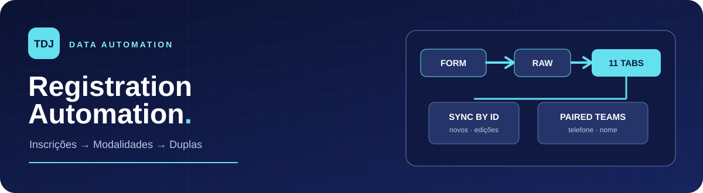
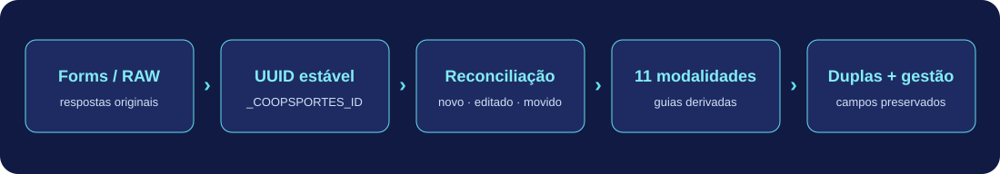
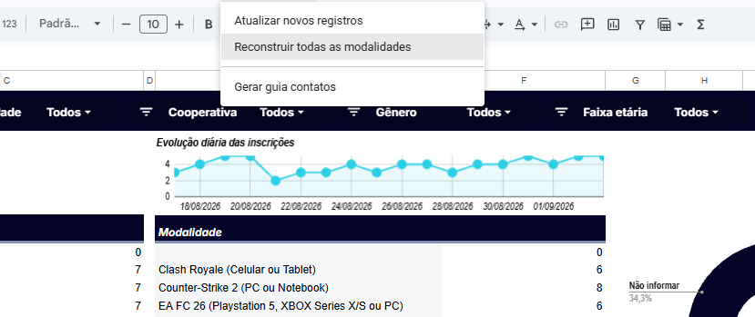
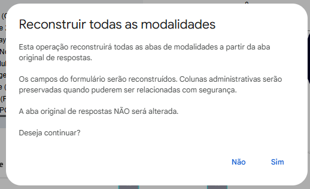
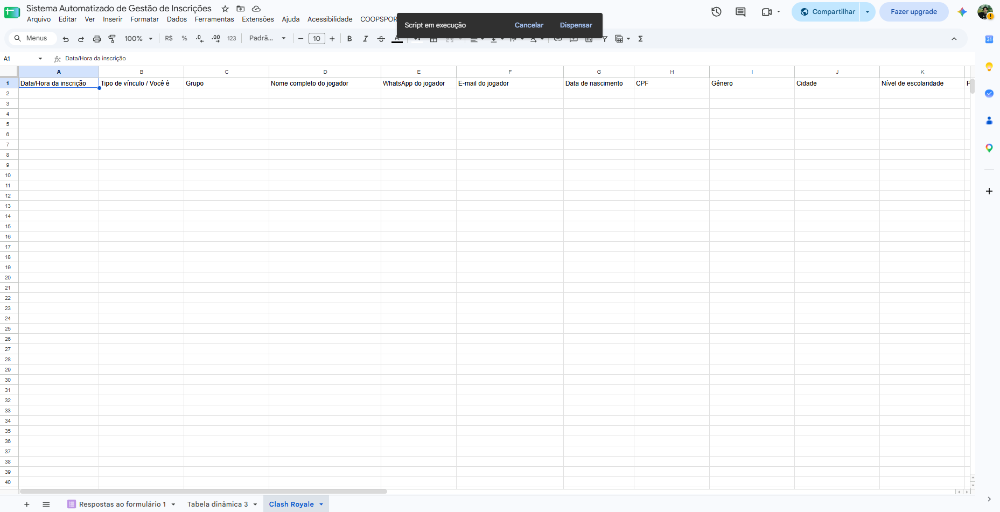
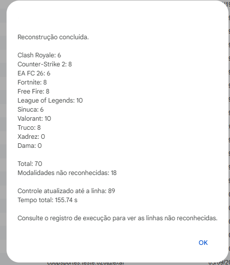
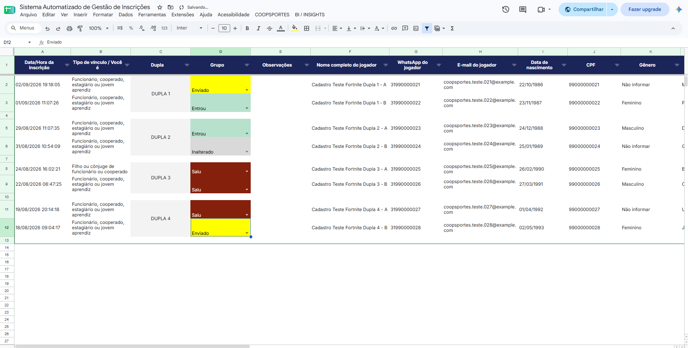

<p align="center">
  
</p>

<p align="center">
  <strong>Google Apps Script · JavaScript · Google Sheets · Google Forms · Processamento em lote</strong>
</p>

Sistema de automação de inscrições desenvolvido para a **TDJ Corporate** no **Coopsportes Digital 2026**. A partir de uma guia de respostas do formulário, o script cria e atualiza **11 guias de modalidades**, organiza inscrições em duplas e preserva os campos administrativos usados pela operação.

> **Demonstração:** os dados mostrados nas capturas foram alterados para preservar a privacidade dos participantes. Números e tempos de execução exibidos nelas são ilustrativos.

## O problema

A equipe precisava transformar respostas de um formulário único em guias prontas para operar cada modalidade. A montagem manual envolvia separar registros, adaptar colunas, organizar duplas, formatar a planilha e repetir tudo quando chegavam novas inscrições ou correções.

O objetivo foi tornar essa estrutura **reconstruível e sincronizável** a partir da fonte oficial, mantendo espaço para as anotações manuais da organização.

## Fluxo da automação

<p align="center"></p>

1. **Fonte única:** o script lê `Respostas ao formulário 1` com `getValues()` e `getDisplayValues()` em blocos.
2. **Identidade estável:** cria e mantém um UUID por inscrição na coluna técnica oculta `_COOPSPORTES_ID` da guia RAW.
3. **Classificação:** normaliza o texto da modalidade e distribui os registros por 11 jogos.
4. **Reconciliação:** compara cada UUID com as guias existentes para identificar inclusões, edições, exclusões e mudanças de modalidade.
5. **Duplas:** agrupa participantes nas modalidades em equipe e escreve a numeração `DUPLA 1`, `DUPLA 2` etc.
6. **Saída operacional:** preserva dados administrativos quando consegue associá-los com segurança e aplica cabeçalhos, formatação e validações.

### Menu e modos de execução

<p align="center"></p>

| Ação | Quando usar | Comportamento |
| --- | --- | --- |
| **Atualizar novos registros** | Rotina de operação. | Reconcilia os cadastros; atualiza diretamente campos simples e reconstrói as modalidades afetadas por mudanças estruturais ou nas duplas. |
| **Reconstruir todas as modalidades** | Primeira montagem ou recuperação da estrutura. | Recria as 11 guias derivadas a partir da RAW e tenta preservar colunas administrativas associáveis. Exige confirmação. |

Não há gatilho `onFormSubmit` nem execução por horário: a sincronização é iniciada pelo menu. As duas rotinas usam `LockService` para evitar execuções simultâneas.

<p align="center"></p>

### Criação e atualização das guias

<p align="center"></p>

As guias cobrem **Clash Royale, Counter-Strike 2, EA FC 26, Fortnite, Free Fire, League of Legends, Sinuca, Valorant, Truco, Xadrez e Dama**. Cada uma recebe os campos comuns do cadastro e as colunas específicas do jogo. O script aceita variações configuradas dos nomes das modalidades; valores que não correspondem ao mapeamento são reportados para correção.

Na atualização incremental, uma modalidade desconhecida interrompe as alterações das guias derivadas. O resumo da execução informa registros novos, atualizados, movidos, removidos e sem mudança, além das modalidades reconstruídas.

<p align="center"></p>

### Organização das duplas

<p align="center"></p>

**Counter-Strike 2, Fortnite, Free Fire e Truco** recebem agrupamento de duplas. O vínculo busca primeiro o WhatsApp informado para o parceiro, priorizando a correspondência recíproca; se não houver correspondência por telefone, tenta o nome normalizado. A coluna **Dupla** numera pares encontrados e deixa espaço para conferência operacional.

> O CPF aparece nos campos do cadastro, mas **não é usado para formar duplas** nesta implementação. Correspondências por nome ou telefone podem exigir revisão humana quando há informação incompleta ou repetida.

## Decisões técnicas

| Técnica | Aplicação no projeto |
| --- | --- |
| **Leitura em lote** | Carrega valores da RAW e das guias para comparar os registros em memória, reduzindo leituras célula a célula. |
| **UUID persistente** | Mantém a identidade da inscrição mesmo quando sua posição na RAW muda; cópias com UUID repetido recebem novo ID. |
| **Atualização seletiva** | Alterações simples são aplicadas diretamente; modalidades com mudança de equipe, inclusão, remoção ou troca de jogo são reconstruídas. |
| **Preservação administrativa** | Mantém, quando a associação é segura, observações, grupo, chave e outros campos preenchidos pela equipe, além de linhas manuais. |
| **Proteção de execução** | `LockService` evita concorrência; `PropertiesService` guarda controles de migração e o último ponto processado. |
| **Saída rastreável** | Logs e resumo da execução mostram contagens, modalidades afetadas, linhas não reconhecidas e duração. |

## Resultado para a operação

A automação **poupou mais de 6 horas de trabalho na construção da planilha**, conforme a estimativa da equipe para a montagem manual substituída pelo script. O ganho principal foi criar a estrutura das modalidades e duplas de forma repetível, com um caminho para atualizar inscrições sem refazer a organização do zero.

O tempo exibido na captura do resumo pertence a uma **execução demonstrativa com dados alterados**; não deve ser interpretado como benchmark de produção nem como a medida das 6 horas poupadas.

## Como executar

1. Use uma planilha Google vinculada ao formulário, com a guia RAW chamada `Respostas ao formulário 1` e cabeçalhos compatíveis com `CONFIG.SOURCE_FIELDS` em [`Script.gs`](Script.gs).
2. Em **Extensões → Apps Script**, adicione o conteúdo de `Script.gs` ao projeto vinculado à planilha. Ajuste `CONFIG.SOURCE_SHEET`, modalidades e aliases se estiver adaptando para outro evento.
3. Recarregue a planilha para criar o menu **COOPSPORTES**.
4. Na primeira montagem, execute **Reconstruir todas as modalidades** e confirme a operação. Depois, use **Atualizar novos registros** na rotina.
5. Revise o resumo, as modalidades não reconhecidas e os agrupamentos de duplas. Execute novamente após corrigir a fonte.

O código adiciona e oculta uma **coluna técnica de UUID na guia RAW**. Ele preserva os campos de resposta do formulário, mas a estrutura da guia de origem recebe essa coluna. Faça a primeira execução em uma cópia da planilha se quiser avaliar a adaptação ao seu formulário.

### Integrações de menu

O `onOpen` deste arquivo também cria itens de **BI / INSIGHTS** e **Gerar guia contatos**. As funções `abrirBiInsightsCoopsportes` e `gerarGuiaContatosCoopsportes` **não estão implementadas neste arquivo**: esses itens só funcionam quando os scripts complementares correspondentes também estão no projeto Apps Script. As duas ações de automação da tabela acima pertencem a este repositório.

## Estrutura

```text
tdj-registration-automation/
├── Script.gs                       # automação de guias e duplas, sem comentários
├── README.md
└── assets/
    ├── header.svg
    ├── data-flow.svg
    ├── menu.png
    ├── rebuild-confirmation.png
    ├── modality-creation.png
    ├── execution-summary.png
    └── paired-teams.png
```

## Limitações conhecidas

- O mapeamento de cabeçalhos é específico do formulário do Coopsportes 2026; outras planilhas exigem adaptar `CONFIG.SOURCE_FIELDS`.
- O vínculo de duplas usa telefone e nome, não confirmação documental automática. Duplicidades da base são preservadas para revisão.
- A reconstrução altera as guias derivadas e preserva dados manuais apenas quando a associação pode ser feita com segurança; acompanhe os avisos da execução.
- O arquivo teve a sintaxe JavaScript verificada localmente; a execução completa depende do ambiente e da estrutura da planilha Google.

## Privacidade

O repositório não inclui a planilha real de inscrições. As imagens usam cadastros de demonstração alterados; confira seus próprios arquivos antes de compartilhar versões futuras.

---

Desenvolvido por **Ezequiel Gomes Rocha** para a **TDJ Corporate**.
